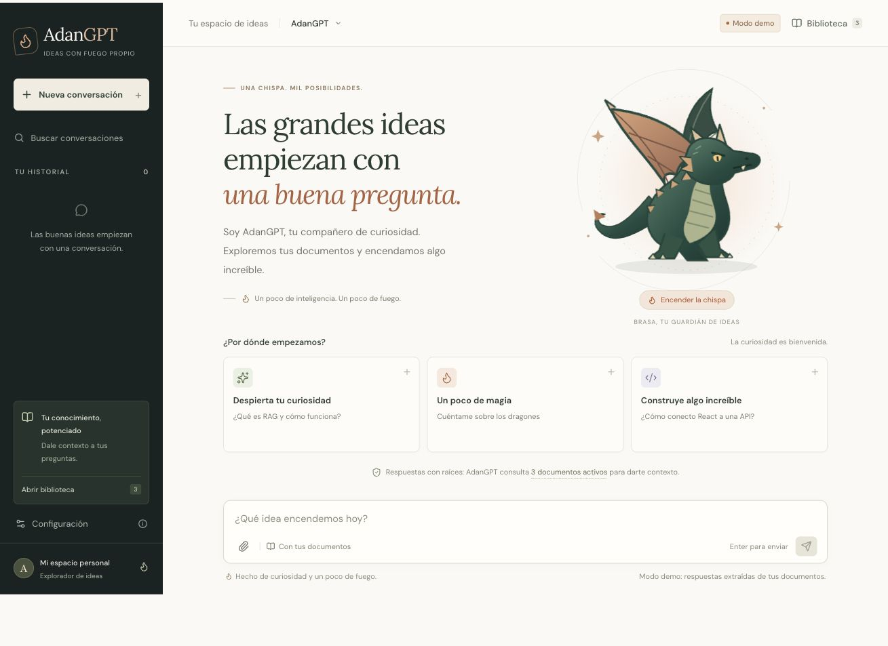

# AdanGPT: enciende tus ideas

**Lab 5 · Endpoint IA.** Aplicación de chat en **React y TypeScript** con una biblioteca de documentos, un endpoint de IA configurable y Brasa, un dragón animado con SVG y CSS que echa fuego al enviar mensajes o presionar **Encender la chispa**.

Funciona inmediatamente **sin una API key real**. En ese caso utiliza un modo demo que recupera y cita extractos de los documentos. La generación con un modelo de IA se activa al configurar una clave en el servidor.



[Vista en tableta](docs/tablet.jpg) · [Vista en móvil](docs/mobile.jpg) · [Registro de verificación](docs/verification.md)

## Ejecutar

Requiere **Node.js 22.12 o superior** y npm.

```bash
cd "Lab5 Endpoint IA"
npm ci
npm run dev
```

Abre [AdanGPT en http://127.0.0.1:3005](http://127.0.0.1:3005).

El comando inicia React con Vite en el puerto **3005** y el servidor de la API en el **3006**. Vite redirige las solicitudes `/api` al servidor. `Ctrl+C` detiene ambos procesos. No es necesario crear `.env` para probar el modo demo.

## Recorrido de demostración

1. Presiona **Encender la chispa** para ver a Brasa echar fuego.
2. Selecciona **Despierta tu curiosidad** o escribe una pregunta sobre RAG, React o dragones.
3. Abre **fragmentos consultados** debajo de la respuesta y comprueba las citas `[1]`, `[2]` y `[3]`.
4. Entra a **Biblioteca** y agrega [`docs/sample-library.md`](docs/sample-library.md).
5. Pregunta: **¿Dónde vive Zephyr y de qué color son sus escamas?** La respuesta debe citar tu nuevo documento.
6. Desactiva el documento de Zephyr y pregunta **¿Qué come Zephyr?** La app reconocerá que no encontró información suficiente.
7. Crea otra conversación. Puedes recuperar las anteriores desde el historial, buscar por su contenido, copiar respuestas y descargar una conversación en Markdown.

## Conectar la API de IA

```bash
cp .env.example .env
```

Edita `.env`:

```dotenv
OPENAI_API_KEY=tu-clave-real
OPENAI_BASE_URL=https://api.openai.com/v1
OPENAI_MODEL=gpt-4o-mini
PORT=3006
```

Reinicia `npm run dev`. La interfaz mostrará **API configurada** y el nombre del modelo en Configuración. Ese indicador significa que el servidor tiene una clave configurada; si la clave es inválida o no tiene cuota, el chat mostrará el error correspondiente al hacer la solicitud.

El servidor utiliza `POST {OPENAI_BASE_URL}/chat/completions`. Se puede usar otro proveedor compatible cambiando la URL y el modelo. Las claves vacías o los ejemplos que comienzan con `tu-`, `your-`, `example`, `placeholder` o `sk-example` mantienen el modo demo.

La clave permanece en **Node**, nunca se envía a React ni se utiliza una variable `VITE_` para guardarla. `.env` está ignorado por Git. No se incluye ninguna clave real en este proyecto.

## Cómo funciona el RAG

```text
Pregunta + documentos activos
             |
      POST /api/chat
             |
   Validación y fragmentación
             |
 Recuperación léxica de hasta 3 fragmentos
             |
      ¿Hay una API key?
        /           \
      No             Sí
      |              |
 Extractos     Contexto + historial
 con citas     enviados al modelo
        \           /
      Respuesta + fuentes
```

La recuperación normaliza acentos y mayúsculas, elimina palabras vacías y ordena fragmentos con una puntuación de frecuencia de términos y frecuencia inversa de documentos (BM25 simplificado). Los documentos se dividen por párrafos en fragmentos de hasta 900 caracteres. Las preguntas breves que hacen referencia a la respuesta anterior pueden reutilizar la pregunta previa para buscar contexto. Los encabezados Markdown aislados se excluyen de los fragmentos y se descartan coincidencias débiles respecto al mejor resultado.

- **Modo demo:** devuelve texto literal de los fragmentos con referencias. No simula una llamada real ni genera respuestas con IA.
- **Modo IA:** agrega los fragmentos a la pregunta y llama al proveedor desde el servidor. La instrucción del sistema pide respuestas en español, citas y reconocimiento de información faltante.
- **Sin coincidencias:** informa que faltan fuentes y no llama al proveedor.

Es un RAG pequeño basado en búsqueda léxica, **sin embeddings ni base de datos vectorial**. No realiza búsquedas en Internet. Los documentos son contexto no confiable, no instrucciones para el modelo; aun así, las respuestas de un modelo deben revisarse contra sus fuentes.

## Funcionalidades y límites

- Tres documentos de ejemplo sobre IA/RAG, dragones y React.
- Archivos `.txt` y `.md`: hasta 12 documentos, 120 KB por archivo, 60,000 caracteres por documento y 240,000 en total.
- Preguntas de hasta 4,000 caracteres; hasta 20 conversaciones con 80 mensajes cada una.
- Historial y documentos almacenados en `localStorage` en este navegador. No hay cuentas ni sincronización entre dispositivos.
- Fuentes desplegables, copia de respuestas, búsqueda de conversaciones y descarga Markdown.
- Cancelación de solicitudes, prevención de envíos duplicados y errores de red, clave, cuota y formato.
- Diseño adaptable, controles con etiquetas, diálogos con gestión de foco y soporte de movimiento reducido.
- El servidor envía al proveedor solo los fragmentos recuperados y hasta 12 mensajes de contexto. El navegador sí envía los documentos activos al servidor para realizar la recuperación.

La app es un laboratorio local, sin autenticación. El servidor escucha en `127.0.0.1`; para publicarla como servicio multiusuario se deben agregar autenticación, cuotas y almacenamiento por usuario.

## Compilar y ejecutar la versión final

```bash
npm run build
npm start
```

Abre [http://127.0.0.1:3006](http://127.0.0.1:3006). Node entrega la interfaz compilada de `dist` y el endpoint en el mismo origen. El proceso utiliza `tsx` como dependencia de ejecución para servir la API escrita en TypeScript.

## Endpoints

| Método | Ruta          | Resultado                                                                         |
| ------ | ------------- | --------------------------------------------------------------------------------- |
| GET    | `/api/health` | Modo `demo` o `live` y nombre del modelo. Nunca expone la clave.                  |
| POST   | `/api/chat`   | Recibe `messages` y `documents`; devuelve `message`, `sources`, `mode` y `model`. |

Ejemplo sin clave:

```bash
curl http://127.0.0.1:3006/api/chat \
  -H 'Content-Type: application/json' \
  -d '{"messages":[{"role":"user","content":"¿Dónde vive Zephyr?"}],"documents":[{"id":"zephyr","title":"Mi dragón","origin":"upload","content":"Zephyr vive en la montaña de obsidiana."}]}'
```

Los cuerpos inválidos responden `400`, las cargas de más de 1 MB responden `413` y los errores del proveedor responden `502` con un mensaje en español. El límite de espera del proveedor es de 30 segundos.

## Validación

```bash
npm run check
npm audit --omit=dev
```

`check` ejecuta **18 pruebas automatizadas**, la comprobación estricta de TypeScript y la compilación de producción con Vite. Las pruebas verifican recuperación y citas, archivos propios, ausencia de contexto, fragmentación, validación de entradas, modo demo sin llamadas externas, envío del contexto al proveedor, tratamiento de claves de ejemplo y errores de red, cuota, formato y tamaño. La integración con IA se prueba con un proveedor simulado; no se requiere ni se consume una clave real.

## Estructura

```text
src/App.tsx                  Chat, historial, biblioteca y configuración
src/components/Dragon.tsx    Ilustración SVG de Brasa
src/components/Modal.tsx     Diálogo accesible
src/components/Markdown.tsx  Respuestas en Markdown, cargadas bajo demanda
src/lib/workspace.ts         Persistencia validada y descarga de conversaciones
src/styles.css               Interfaz adaptable y animación del fuego
shared/documents.ts          Biblioteca de ejemplo
shared/types.ts              Contratos compartidos
server/app.ts                Validación, endpoint y conexión al proveedor
server/rag.ts                Fragmentación y recuperación léxica
server/*.test.ts             Pruebas de recuperación y API
scripts/dev.mjs              Inicio y detención de Vite y Node
```

## Referencias

- [React: documentación oficial](https://react.dev/learn)
- [Vite: guía de inicio](https://vite.dev/guide/)
- [OpenAI: Chat Completions](https://developers.openai.com/api/reference/resources/chat/subresources/completions/methods/create)

La ilustración y las animaciones se construyen con SVG y CSS. Los iconos pertenecen a Lucide. Las tipografías DM Sans y Lora se cargan de Google Fonts; sin conexión se utilizan las fuentes de respaldo del sistema.
